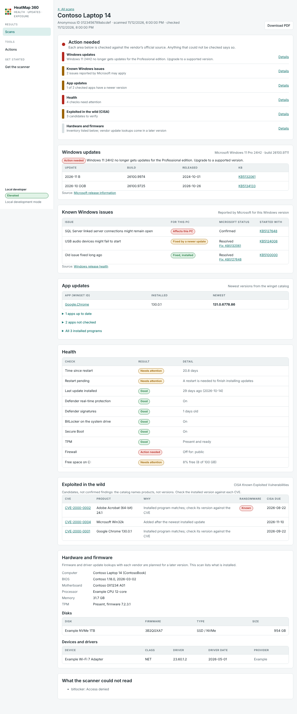

# HeatMap 360 (hm360)

Scan any Windows computer and find out, from the vendors' own sources, whether it is up to date and whether anything
installed on it has a known problem or a vulnerability that is being exploited in the wild. Alongside the scans,
HeatMap 360 gathers cloud service health, security and patch news, and official vendor posts on one admin-friendly
dashboard, keeps one inventory catalog of every version seen, and shows weekly security posture checks of Active
Directory (PingCastle, BloodHound CE, AD Miner), Entra ID (Maester), and Microsoft 365 and Azure (Monkey365).

HeatMap 360 reports findings only. It never installs, updates or changes anything on a computer, and it never posts
anywhere. Fixing things belongs to Remediation 360.



## What a scan checks

* **Windows:** is the installed build the latest for its version, which updates are missing, is the version (for its
  edition) still getting updates, and which issues Microsoft has reported for this exact build and for the installed
  updates.
* **Apps:** installed programs and, for every winget package, whether a newer version exists.
* **Known issues in apps:** "Known issues" / "Unresolved" sections from each publisher's release notes (linked from
  the winget catalog, and the app's own GitHub release), for the installed version and the available update.
* **Exploited in the wild:** installed programs and the Windows build matched against CISA's Known Exploited
  Vulnerabilities catalog, then checked against the affected version ranges in each official CVE record: "Vulnerable
  version", "Check version" (the record has no usable version data) or patched.
* **BIOS:** for HP, Lenovo and Dell, whether the vendor's update catalog has a newer BIOS; for other makers, the BIOS
  age and a link to the maker's support site.
* **Driver updates:** which driver updates Windows Update offers this computer (the scanner only searches; it never
  installs).
* **Health:** Defender, BitLocker, Secure Boot, TPM, firewall, free space, restart pending.
* **Event log:** blue screens, hardware (WHEA) errors, disk errors, unexpected restarts, failed updates and crashes in
  the last 7 days, from counts per event ID (message text is never collected).
* **Network adapters:** link speed and duplex, old drivers, power and Energy Efficient Ethernet settings, Wi-Fi
  signal, band and standard (no addresses or network names).
* **Network health:** ping time and loss to the router, connection time to the internet, DNS lookup time, and
  download/upload speed against Cloudflare's public speed test (about 35 MB; `-SkipSpeedTest` leaves it out).
* **Disk and battery health:** disk wear, temperature and uncorrected errors (run as administrator), battery
  capacity versus new.
* **Hardware:** make, model, motherboard, CPU, memory, disks, device drivers.

Every lookup can fail on its own. That section then says "Not checked" with the reason, and the rest still completes.

## Pages

**New hire** (public, no sign-in; top of the left pane, as in Remediation 360)

* **Overview:** the page visitors land on before they elevate. What HeatMap 360 is and will not do, how a scan moves
  through it in six steps, what every page in the left pane does, a first week for a new owner, the words you will
  hear, and what is not built yet.
* **How To Guide:** seven steps from downloading the scanner to reading the results, what HeatMap 360 does at each
  step, what each component is looked up against, what the result words mean, and troubleshooting.
* **Get the scanner:** download the scanner and upload a scan file.
* **Scanner vs Intune & Defender:** what the scanner collects compared with Microsoft Intune and Microsoft Defender,
  what each costs, and why HeatMap 360 does its own lookups.

**Results** (admins with an active PIM elevation)

* **Scans:** every scan, newest first, and a page per scan with its grade and every finding. Each scan also downloads as one .mhtml file.
* **Pen tests** (under Scans): penetration testing write-ups, each with a short synopsis and a link to the original.
  For reading only; HeatMap 360 runs none of these tools. The list is `PEN_TESTS` in `public/app.js`.
* **Inventory catalog** (under Scans): every software, driver and firmware version and Windows build seen on any
  scanned computer, stored once: which computers run it, whether an update exists, known problems, every CVE for that
  exact version (NVD for apps, drivers and BIOS; the Microsoft Security Update Guide for Windows builds), CISA
  exploited flags, driver updates Windows Update offers, and a history of installs, version changes, removals and
  newly found problems. Weaker NVD product matches wait for an admin's Confirm on the page. A failed lookup keeps the
  last good answer.
* **Vulnerability scans** (under Scans): a placeholder, not built yet.
* **AD posture** (under Scans, local copy only): Active Directory risk scores from 0 to 100 (lower is better) in four
  areas (stale objects, privileged accounts, trusts, anomalies) from a weekly PingCastle health check, over time:
  what was found, what is new and what was fixed.
* **Attack paths** (under Scans, local copy only): who can reach Domain Admins and other risky Active Directory
  settings, from a weekly BloodHound Community Edition collection run in containers. The page also shows the ratings
  of the newest **AD Miner** report (about 60 checks, each rated immediate, potential or minor risk, or handled), built
  on demand from a copy of BloodHound's data in a container with no network, and offers every report as a download.
* **Entra posture** (under Scans, local copy only): several hundred Entra ID and Microsoft 365 checks (Conditional
  Access, authentication methods, privileged roles, app consent, guest access, Intune, and the CISA, CIS and EIDSCA
  baselines) from a weekly Maester run in a container: the pass rate over time, what failed, what is new and what was
  fixed. Maester signs in with a read-only app and a certificate.
* **M365 & Azure posture** (under Scans, local copy only): CIS Microsoft 365 Foundations and CIS Microsoft Azure
  Foundations checks of Exchange Online, Teams, Purview and Azure from a weekly Monkey365 run in a container, beside
  Maester's Entra ID checks. Monkey365 signs in with an app that has Global Reader and Azure Reader only.
* **Chaos Monkey** (under Scans): one button per hardening test (NTLM, SMB, LDAP and coercion, name resolution,
  Kerberos and RC4, pass-the-hash, AD CS, printers, Windows LAPS, Entra sync, AD hygiene, enforcement changes). Each
  button creates that test as a Remediation 360 change, which Intune runs on the machines picked there. Every test
  only reads and asks, never changes a machine, and reports PASS, FAIL or COULD NOT TEST.
* **High impact:** one short list of what deserves attention now, each item with the reason it made the cut and links
  to its sources. Exploits: vulnerabilities CISA added to its Known Exploited Vulnerabilities catalog in the last 7 days,
  and headlines from the Exploits and Patches feeds whose title says zero-day, actively exploited, under attack,
  emergency patch or out-of-band (merged by CVE). Disruptions: any outage on a Service health feed, and degradations
  lasting 2 hours or more. Critical: ransomware use, 3 or more feeds on one CVE, an outage, or a degradation of 8 hours
  or more. The rules live in `RULES` in `server/attention.mjs` and are shown on the page. It tracks what is happening
  in the wild; "Are we affected?" checks the scanned computers against it.
* **Are we affected?** (under High impact): every exploit on High impact checked against the newest scan of each
  computer. Each computer gets Vulnerable version, Check by hand, Patched or Not installed, and each exploit a call:
  Act now (vulnerable and critical), Affected, Check by hand, Cannot check (the headline names no CVE), Not affected.
  The bot's own verdict is used when it judged that CVE; otherwise the same CISA KEV + CVE record version check runs
  in the web app (`server/exposure.mjs`), so older scans are checked against newly listed CVEs without a new scan.
  Scans older than 30 days are marked old.
* **Internet - Cloud Services:** headlines from Azure updates, the AWS News Blog, the Google Cloud Blog, the Cloudflare
  Blog and The Register's cloud section.
* **Internet - Exploits:** CISA advisories, the Microsoft Security Update Guide, SANS Internet Storm Center,
  BleepingComputer, The Hacker News, SecurityWeek, Krebs on Security, Cloudflare Zero Wire (write-ups of major new
  flaws) and newly published Critical CVEs from Cloudflare Radar.
* **Cloudflare Radar CVEs:** newly published CVEs from Cloudflare Radar's free public CVE feeds (built from the CVE
  List and NVD, with CISA's known-exploited dates). Filter by severity, timeframe, known exploited, and search by
  CVE ID or keyword. Each feed holds the newest 100 CVEs, so HeatMap reads one per severity: Critical and High go back
  several days, Medium and Low about a day, and unscored ones about an hour. Search covers what was read, not all of
  Cloudflare's 400,000+ CVEs; each CVE links to its Cloudflare page.
* **Internet - Patches:** 11 patch news feeds (BleepingComputer, Born's Tech and Windows World, Windows IT Pro Blog,
  Zero Day Initiative, Windows Latest, Neowin, The Register: Patches, Patch My PC, gHacks, Chrome Releases, Tenable).
* **x.com:** placeholder with the same five timeframes; not populated yet.
* **Bluesky:** the latest posts from the top 50 official vendor accounts for patches, updates, security and service
  health, plus every official Microsoft account, read from Bluesky's free public API with no account. Newest first or by account; replies on demand with
  "Show replies".
* **Incident cases:** one record per security incident, run through the NIST SP 800-61 lifecycle (Detection and
  analysis, Containment, Eradication and recovery, Post-incident activity). Triage uses NIST's three impact categories
  to set the severity (high or critical says escalate). Each incident type (exploited vulnerability, ransomware,
  phishing, credential compromise, malware, cloud disruption) has a playbook checklist with its MITRE ATT&CK
  techniques, and "Where to act" links to Remediation 360 (Emergency, Changes), Entity 360 and Federation 360:
  HeatMap 360 itself changes nothing. The timeline is append-only; evidence (High impact items with their "Are we
  affected?" result, scan snapshots, written evidence) is stored with a SHA-256 hash that is checked again each time
  the case opens. Closing needs the post-incident review, locks the case, and the review downloads as a PDF. "Open a
  case" on High impact and Are we affected? starts one with that item as evidence. Cases live in the data store
  (`cases/<id>.json`; the local data folder in development) and every change needs the case's current version.
* **Service health:** Microsoft 365 (tenant service health from Microsoft Graph, read with the app's managed
  identity), Azure, AWS, Google Cloud, Google Workspace, GitHub and Cloudflare from their own status feeds.

The news and Bluesky pages show the last 7 days (the default), 3 days, 8 hours, 4 hours or 1 hour; sort by source or by
time; and hide sources. Each ticked source in the left pane shows how many of its articles or posts are on screen for
the chosen timeframe. Headlines link to the source. Feeds are cached for 30 minutes (Bluesky for 15).

Every section on every page folds and starts folded, so a long page opens as a short list of headings.

Every button, link-button and form shows that it is working: its own wording while it waits ("Uploading…", "Building
PDF…", "Searching…"), a spinner, no double press, then a confirmation or a red error next to it. Opening a page shows
"Loading <page>…". New controls must do the same; `tests/busy.test.mjs` fails if one does not.

**Tools**

* **How to set up:** how to set up every part of HeatMap 360: the local and hosted copies, the bot and findings job,
  and the PingCastle, BloodHound, AD Miner, Maester and Monkey365 scans, each with what runs where and how to remove
  it.
* **Options:** builds the scanner command (speed test on or off, save only, wait time).
* **Settings** (Settings Admin group, PIM-activated): which Azure storage account and table hold the findings
  table, so the storage can move without a code change.

## How it works

```
 any Windows PC                     HeatMap 360 (Azure Container Apps)         hm-360-data (private GitHub repo)
 Invoke-HeatMapScan.ps1 ── HTTPS ──▶ POST /api/scans  ── contents API ──────▶ inbox/<id>.json
   (anonymized inventory)            validates, rate limits, scrubs                    │ push wakes the workflow
                                                                                       ▼
 .mhtml ◀─ ticket ─ GET /api/scans/<id>/report.mhtml   admin desktop: self-hosted runner → bot/run.mjs
                                     ▲                    checks Microsoft, winget, CISA, CVE, HP/Lenovo
 admins (Entra + active PIM group) ──┘ results pages  ◀── results/<id>.json ◀────────────┘
                                                                                       │
                                     findings table (Azure Table Storage) ◀── bot/findings.mjs (scheduled)
```

1. **Scanner** (`client/Invoke-HeatMapScan.ps1`): anyone can run it; no account needed. It is read-only, leaves out
   names, addresses and serial numbers, and identifies the computer only by a hash of its MachineGuid. Two steps: a
   scan only saves the anonymized file (nothing is sent); the user uploads it with the Upload button on the "Get the
   scanner" page or with `-Upload` (which waits for the results and saves an .mhtml file). `-ScanAndUpload` does both, and
   `-Resume <scan id>` fetches the results file of an earlier upload.
2. **HeatMap 360** (`server/`): an open upload endpoint with a 1 MB limit, per-IP and global rate limits, a strict
   schema (unknown fields rejected) and a second scrub for anything personal. It stores the upload in `hm-360-data`
   with only a hash of the uploader's one-time ticket. The GitHub token sits in the server, never on a client.
3. **Bot** (`bot/`): runs on the admin's desktop as a GitHub Actions self-hosted runner job (`bot/process.yml`), started
   by GitHub when an upload lands (and hourly to catch up). It writes `results/<id>.json`.
4. **Results**: the uploader gets one .mhtml file (a single web page archive that opens offline in Edge or Chrome; no PDF). People signed in with Entra who have **activated the HeatMap 360 PIM group**
   see every scan live; access ends when the activation ends (re-checked every 5 minutes).
5. **Findings store and inventory catalog** (`bot/findings.mjs`, `bot/catalog.mjs`): every item from every scan goes
   into one Azure Table Storage table, one row per item per computer (keyed by the anonymous machine ID), and each
   distinct version is stored once with its lookups and history; the job writes `catalog/catalog.json` for the
   Inventory catalog page. A background job on the admin desktop looks each
   distinct item up again with the same official sources (rechecked about once a day), so a newly reported problem
   or a newly exploited vulnerability is flagged without a new scan. It signs in with Entra (the desktop's
   `az login`); no keys or connection strings. The storage account is created by hand in Azure, never by code; the
   job only creates the table inside it.

## Run it locally

```powershell
npm install
$env:HM360_DEV_ADMIN = '1'; npm start                        # http://localhost:3460, local data in data\exchange, no sign-in
.\client\Invoke-HeatMapScan.ps1 -Server http://localhost:3460 -ScanAndUpload -WaitMinutes 1
node bot\run.mjs --repo data\exchange                        # process the upload; refresh the page
node bot\findings.mjs --repo data\exchange --dry-run         # optional: fill the findings store in memory only
```

Dev admin mode treats the browser as an elevated admin. It only works on 127.0.0.1 and is refused in production or
when Entra or the GitHub data repo is configured. The Microsoft 365 card reads "Not connected" locally, because it
needs the Azure managed identity.

Or run the web app in a container (Docker Desktop). Same local dev mode, same `data\exchange` folder, port published on
127.0.0.1 only. The bot still runs on the host as above.

```powershell
docker compose up -d --build                                 # http://localhost:3460
docker compose logs -f hm360                                 # watch it
docker compose down                                          # stop
```

AI assistants (Claude Desktop, Claude Code) can read the local copy through the read-only MCP server in
`mcp/server.mjs`: scans, High impact, service health, the Internet pages, Bluesky and Cloudflare Radar CVEs. Setup and
tools: [docs/MCP.md](docs/MCP.md).

Hosted setup (Entra app, PIM groups, data repo token, runner, findings store, Container Apps, settings):
[docs/SETUP.md](docs/SETUP.md). Design and data formats: [docs/DESIGN.md](docs/DESIGN.md).

## Rules

* The posture tools (PingCastle, BloodHound, AD Miner, Maester, Monkey365) only read. Their reports stay in a local
  folder the web app reads, and the cloud ones sign in with read-only apps and certificates.
* No secrets in git. Sign-in uses a managed identity (no client secret); the data token is a Container Apps secret.
  The findings job signs in with Entra; no storage keys.
* The scanner and the bot only read. Nothing is installed, updated or changed on any computer, and HeatMap 360 never
  posts to any site.
* Scan results use official sources only: Microsoft release health, the winget catalog and the publisher release notes
  it links, CISA KEV, CVE records, HP, Lenovo and Dell update catalogs. The inventory catalog also reads the NVD CVE and CPE API
  and the Microsoft Security Update Guide (no keys), and the scanner asks Windows Update which drivers it offers
  (search only). The Internet pages read the public RSS/Atom feeds
  listed in `server/news.mjs`, and the High impact page reads the CISA KEV catalog plus those same feeds and the
  Service health feeds; the Bluesky page reads Bluesky's free public API for the accounts in
  `server/bluesky.mjs`; the Cloudflare Radar CVEs page reads Cloudflare Radar's free public CVE JSON feeds listed in
  `server/cves.mjs`. No other scraping.
* Every button shows it is working (see Pages).
* $0: Container Apps free grant (scales to zero), GitHub free, free public feeds, Azure Table Storage at cents a month.

## Not built yet

* Matching scans against the news and social feeds, with a verdict per product (for example "Upgrade now: exploited"
  or "Watch for issues"). The exploits on High impact are already matched, on "Are we affected?".
* AI-assisted lookups of known issues for each component (the How To Guide says this is coming).
* Posts on the x.com page.
* Vulnerability scan results.
* BIOS lookups for makers other than HP, Lenovo and Dell.
* Findings in the MCP server: it reads the page APIs only, and the findings table has no page yet.
* Tested only on one desktop so far: HP business and Lenovo BIOS lookups, laptops (battery) and other computers are
  not yet tried on real hardware.

## Recent changes

* **New hire** section at the top of the left pane (Overview, How To Guide, Get the scanner); visitors who are not
  elevated land on Overview, elevated admins on Scans.
* Article counts next to each source and new timeframes (7 days default, 3 days, 8 hours, 4 hours, 1 hour) on the news
  and Bluesky pages; each feed reads its newest 15 articles.
* **High impact** page: newly exploited vulnerabilities, zero-day headlines and long or severe outages.
* Cloudflare Zero Wire and Critical CVE feeds on Internet - Exploits, and the **Cloudflare Radar CVEs** page.
* Busy feedback on every button, link-button and form.
* Read-only **MCP server** so AI assistants can read the local copy ([docs/MCP.md](docs/MCP.md)).
* **Pen tests** reading list and a **Vulnerability scans** placeholder under Scans.
* **Are we affected?**: High impact exploits matched against the newest scan of every computer.
* **Incident cases**: NIST lifecycle, triage and severity, playbooks with ATT&CK, timeline, hashed evidence, review PDF.
* **Scanner vs Intune & Defender** page under New hire.
* **AD posture** (PingCastle), **Attack paths** (BloodHound CE and AD Miner), **Entra posture** (Maester) and
  **M365 & Azure posture** (Monkey365), plus the **How to set up** page.
* **Chaos Monkey**: hardening tests that become Remediation 360 changes run by Intune.
* **Inventory catalog**: each version stored once with its history, every CVE (NVD, MSRC), Windows Update driver
  offers and Dell BIOS.
* Every section on every page folds and starts folded.
* The uploader gets one .mhtml results file instead of a PDF.

## Tests

`npm test` and `npm run check`. Tests also guard the UI rules (busy feedback on every control, the shared 360 layout)
and the MCP server's read-only, local-only gate. Fixtures use fictional data (`contoso.example`, sample CVE IDs). Every pull request
also runs a security gate (`.github/workflows/security.yml`): dependency audit, secret scan and the tests, with
Dependabot keeping dependencies current.

